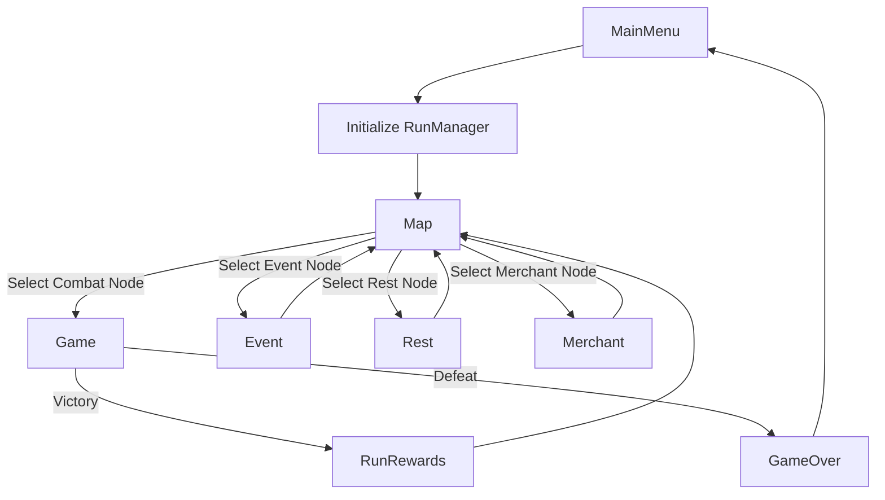

# Scenes and Game Flow

The game flow relies on transitioning between specialized Unity scenes based on the node selected on the Map.

## Core Scenes List

1. **`Loading.unity`**
   - Contains `LoadingSceneController`. Used as a buffer for asynchronous scene loading and displaying splash screens.
2. **`MainMenu.unity`**
   - Title screen, options, and entry point to start a new run (initializes `RunManager` and pushes to `Levels` or `Map`).
3. **`Levels.unity`**
   - Act selection screen (if manual progression is enabled) via `LevelSelectController`.
4. **`Map.unity`**
   - The central rogue-like map where the player chooses their path. Triggers transitions to combat, events, or shops.
5. **`Game.unity`**
   - The primary combat scene. Contains all battle-related systems (`ActionSystem`, `CardSystem`, `EnemySystem`).
6. **`RunRewards.unity`**
   - Triggered upon winning a combat. Allows the player to pick cards, potions, or relics to add to their `RunManager` state before returning to the map.
7. **`Event.unity`**
   - Narrative choose-your-own-adventure nodes. Uses `EventController` to parse text and button choices.
8. **`Rest.unity`**
   - Campfire node. Players can heal or upgrade cards.
9. **`Merchant.unity`**
   - Shop node. Players spend accumulated gold on cards and relics.
10. **`GameOver.unity`**
    - The death screen. Clears run data and allows returning to the main menu.
11. **`GameTutorial.unity` & `DialogueTutorial.unity`**
    - Scripted starting environments teaching mechanics, utilizing `TutorialManager`.

## Transition Flow

